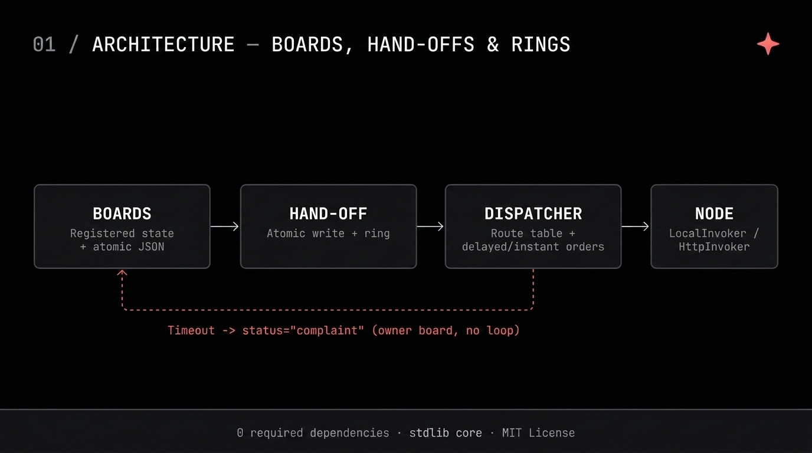

<p align="center">
  
</p>

<p align="center">
  <a href="LICENSE"></a>
  
  
</p>

---

**Anchor** (**A**synchronous **N**ode **C**oordination via **H**and-offs, **O**rders & **R**ings) is a stdlib-only state and wake-up coordination library for multi-node agent systems.

- **[`vorlabs-drift`](https://github.com/becksanswerr/drift)** decides *which machine* should run a job (reverse auction).
- **`vorlabs-anchor`** holds *where the job stands* (registered blackboards, DAG task plans, leases) and *wakes the right node at the right time* (atomic hand-off + route-checked dispatcher).

Neither library depends on the other.

---

## 01 / Architecture

<p align="center">
  
</p>

- **`BoardStore` (`anchor.boards`)** — Registered blackboards (`strict=True` by default; unregistered writes raise `BoardError`), pending-safe pruning (terminal entries are evicted above the limit, never `blocked`/`assigned`/`new` items), and atomic JSON persistence.
- **`TaskBoard` (`anchor.tasks`)** — Ordered DAG plans (`set_plan`, `waits_for`, `bind_card`, `step_done`), failure cascading (`blocked_by_failure`), `suspend`/`resume` (suspended tasks never time out), and mid-flight instructions.
- **`hand_off` (`anchor.handoff`)** — Indivisible write-to-board + ring-dispatcher call; write failures raise `HandoffError` without ringing, and ring failures mark the written entry `undelivered`.
- **`Dispatcher` (`anchor.dispatcher`)** — Route-table allowlist (`RouteRule`), instant or delayed (`delay_seconds > 0`) orders, timeout complaints (`status="complaint"` to `owner_board` without self-retriggering), and restart recovery that never re-runs already-expired orders.
- **`LeaseTable` (`anchor.leases`)** — In-memory TTL leases for singleton background loops.

---

## 02 / Installation

```bash
pip install git+https://github.com/becksanswerr/anchor.git
```

Optional extras:

```bash
pip install "vorlabs-anchor[http] @ git+https://github.com/becksanswerr/anchor.git"   # FastAPI / uvicorn adapter (anchor.http)
pip install "vorlabs-anchor[drift] @ git+https://github.com/becksanswerr/anchor.git"  # Multi-machine routing example with vorlabs-drift
```

---

## 03 / Quick Start (`examples/01_pipeline.py`)

```python
from anchor import BoardStore, Dispatcher, LocalInvoker, RouteRule, TaskBoard, hand_off

boards = BoardStore(boards=["planning", "work", "review"])
tasks = TaskBoard()
task = tasks.create(task_id="job-1", title="Draft release notes")
tasks.set_plan(
    task["id"],
    [
        {"step_id": "1", "action": "Gather changelog"},
        {"step_id": "2", "action": "Review summary", "waits_for": ["1"]},
    ],
)

invoker = LocalInvoker()
dispatcher = Dispatcher(
    boards,
    invoker,
    tasks=tasks,
    routes={
        "planning": RouteRule({"planned"}, ("planner",)),
        "work": RouteRule({"assigned"}, ("worker",)),
        "review": RouteRule({"ready"}, ("reviewer",)),
    },
)

invoker.register(
    "planner",
    lambda p: {"bound": tasks.bind_card("job-1", "1", hand_off(boards, dispatcher, "work", "planner", "assigned", {"step": "1"}, "worker", task_id="job-1"))},
)
invoker.register(
    "worker",
    lambda p: tasks.step_done("job-1", "1", "done", result="Changelog collected"),
)

hand_off(boards, dispatcher, "planning", "api", "planned", {"goal": task["title"]}, "planner", task_id="job-1")
while dispatcher.list_orders(status="queued"):
    dispatcher.tick()
```

---

## 04 / Delayed Orders & Timeout Complaints (`examples/02_delayed_and_timeout.py`)

Every component accepts an injectable `clock`, so time-based scheduling and timeout recovery can be tested deterministically without `sleep()`:

```python
from anchor import BoardStore, Dispatcher, LocalInvoker, RouteRule, hand_off

now = [1000.0]
clock = lambda: now[0]

boards = BoardStore(boards=["jobs", "supervisor"], clock=clock)
invoker = LocalInvoker({"worker": lambda payload: {"async": True}})
dispatcher = Dispatcher(
    boards,
    invoker,
    routes={"jobs": RouteRule({"assigned"}, ("worker",), owner_board="supervisor")},
    clock=clock,
)

hand_off(boards, dispatcher, "jobs", "scheduler", "assigned", {"task": "nightly-index"}, "worker",
         delay_seconds=30, timeout_seconds=60)

now[0] = 1030.0
dispatcher.tick()   # promotes & dispatches
now[0] = 1095.0
dispatcher.tick()   # marks timed_out and writes status="complaint" to "supervisor"
```

### Running it for real

`tick()` is explicit so tests and single-threaded apps stay deterministic. In a long-running process,
let the dispatcher drive itself — node wake-ups run in a worker pool, so one slow node never holds up
the others:

```python
dispatcher.start(interval=1.0, max_workers=4)   # background tick loop
...
dispatcher.stop()
```

Finished orders are pruned automatically (`max_finished_orders`, default 500); queued, scheduled and
running orders are never dropped, because restart recovery needs them.

---

## 05 / Born Inside Valori

Anchor was extracted from the coordination spine of **Valori** — an autonomous multi-node personal AI system running continuously across local hardware. Every invariant in Anchor's test suite (`tests/test_anchor_invariants.py`) comes directly from production failure modes solved in Valori:

- Never evicting `blocked` cards during board pruning
- Failing loudly on `hand_off` instead of stranding work silently
- Routing timeouts to an owner board as `complaint` without re-triggering routes
- Never re-running expired orders after a process restart
- Exempting suspended (`needs_input`) tasks from execution timeouts

*(VorAgents support: upcoming.)*

---

## 06 / Examples

- [`examples/01_pipeline.py`](examples/01_pipeline.py) — Single-process `planner -> worker -> reviewer` pipeline
- [`examples/02_delayed_and_timeout.py`](examples/02_delayed_and_timeout.py) — Delayed order + timeout complaint with a fake clock
- [`examples/03_with_drift.py`](examples/03_with_drift.py) — Anchor decides *when* a node wakes, a real `vorlabs-drift` reverse auction decides *where* it runs (run it on two machines to see the auction choose)

---

## License

MIT — see [LICENSE](LICENSE). Built by [Vorlabs](https://vorlabs.co).
